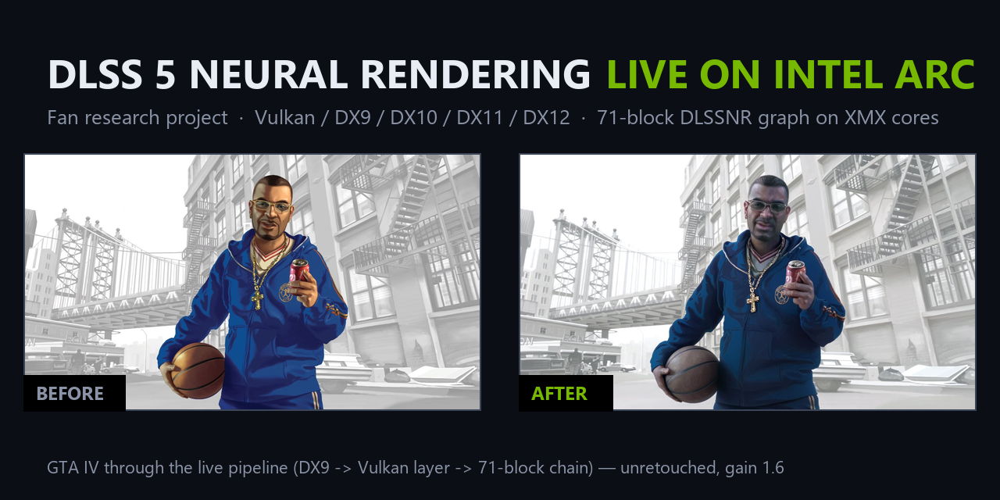
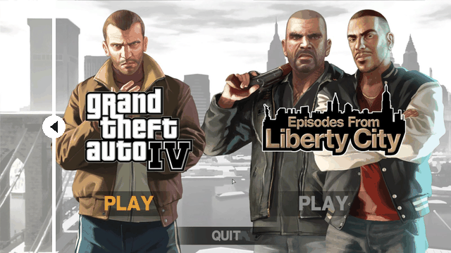
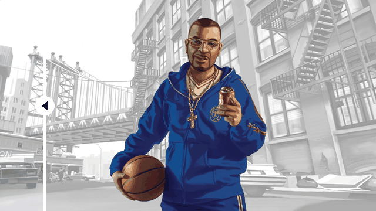
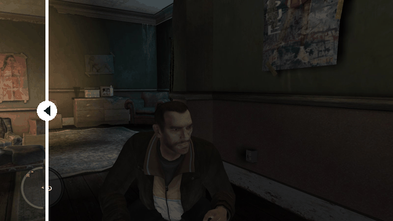

# DLSS5_INTEL

**DLSS 5 Neural Rendering, running live on Intel Arc — a fan research project.**

This project takes the real DLSS 5 neural-rendering model (the 71-block DLSSNR
graph) and runs it on **Intel Arc GPUs** through Vulkan (`VK_KHR_cooperative_matrix`,
XMX cores) instead of NVIDIA tensor cores. It processes **live game frames at
present time** — for Vulkan titles through an implicit Vulkan layer, for
DirectX 9/10/11 through DXVK + the same layer, and for DirectX 12 through a
custom DXGI proxy. A screen/window mode processes the whole desktop or one
window through DDA capture and a click-through Vulkan overlay.

> ⚠️ **Fan project. Not a product.** Not affiliated with or endorsed by NVIDIA
> or Intel. We do **not** use any NVIDIA source code, and we do **not**
> distribute the model weights (NVIDIA proprietary data). DLSS and NVIDIA are
> trademarks of NVIDIA Corporation. Everything here is research and engineering
> demonstration.

[Русская версия README](README.ru.md)



---

## Current status — honest demo build

This is a working proof-of-concept, not a usable everyday tool. What you should
expect today:

| Area | Status |
|---|---|
| Vulkan games (implicit layer) | ✅ Works — validated end-to-end on vkcube, live-tested on RDR2 (Vulkan) |
| DX9 / DX10 / DX11 games (via DXVK → Vulkan) | ✅ Works — validated live on GTA IV (DX9, 32-bit) |
| DX12 games (own `dxgi.dll` proxy) | ✅ Works mechanically — validated on windowed DX12 titles |
| Auto-deploy of the right DLLs per game | ✅ Works — API auto-detection, per-mode DLL set, one UAC prompt for Program Files games |
| Auto game discovery | ✅ Works — Steam / Epic / GOG manifests + full-drive scan, PE-based API detection (finds real games, not every `.exe`) |
| In-game overlay (`CTRL+ALT+G`) | ✅ Works — Game Bar style: topmost, never takes the game's foreground (no minimize), cursor unclip (`AttachThreadInput`); photo-mode freeze and focus steal are opt-in settings |
| Screen / window mode (whole desktop) | 🟡 Works, but slow and rough — fine for streaming demos, not for daily use |
| **FPS & Performance** | 🟡 **Targeting Performance 50% preset + FrameGen.** Full 71-block chain is ~210 ms @ 960x576 (scale 0.50) and ~547 ms selftest / 767 ms steady @ 1080p native on Arc Pro B50 (down from 867 ms in v0.2, -320 ms reduction). Frame generation is a real 1:2 cadence (every 2nd frame through the network, the frame between generated from it by motion-compensated residual transfer, ~0.05 ms @ 640x384; x64 in-process only). See [docs/BENCHMARKS.md](docs/BENCHMARKS.md) |
| Pause / resume | ✅ `CTRL+ALT+X` — full game FPS while paused |

The performance roadmap and optimization history are documented in
[docs/BENCHMARKS.md](docs/BENCHMARKS.md) and [docs/ARCHITECTURE.md](docs/ARCHITECTURE.md#performance);
the correctness of the neural path is validated bit-exactly against PyTorch goldens.

## Performance Target & Positioning (v0.3 Release)

- **Official Target:** **"Performance 50% preset (960x540 internal -> 1080p display) with Adaptive FrameGen for smooth gameplay."**
- **Hardware Ground-Truth on Intel Arc Pro B50 (Vulkan 1.4.348, XMX Xe2):**
  - **Scale 0.50 (960x576 extent):** **210.2 ms steady** (247.3 ms cold, down from 232.8 ms in v0.2) across all 71 blocks.
  - **Scale 1.00 (1080p native 1920x1088 extent):** **547.0 ms selftest / 767.5 ms steady** (down from 867.2 ms in v0.2, **-320.2 ms total reduction**).
  - **FrameGen (1:2 residual transfer):** every 2nd present is neural-processed, the present in between = native + motion-warped DLSS 5 residual of the last processed frame (`framegen.comp` mode 1, ~0.05 ms @ 640x384). No extra latency, no extra present; static scenes reproduce the processed frame bit-exactly. x64 in-process path only.
  - **In-Process Front-End Transport:** **1.5 - 2.5 ms** (0 ms socket lag via direct C ABI).
  - **Numerical Accuracy:** **45.05 dB PSNR vs FP16 reference** (100.00% bit-exact across optimizations, 0 NaNs / 0 Infs).
- **Core v0.3 Breakthroughs — "Bytes Instead of TF/s":**
  1. **Flash-Attention Kernel Fusion (`attn_fused.comp`):**
     - Single workgroup per 64-token window. Q staged in 2 KB shared memory; K and V stream directly from L1/L2 cache via `coopMatLoad`.
     - $S = QK^T$ in cooperative matrix registers with on-chip softmax (subgroup max/exp/sum reduction) and fused $P V$ accumulation.
     - **Eliminated 124 dispatches per frame** (186 -> 62 attention dispatches).
     - **DRAM buffers `oSCW` (46 MB) and `oPRW` (23 MB) completely eliminated** (-15.12 GB DRAM traffic saved per frame at 1080p).
     - Rollback safety: `D5C_INT8_ATTN_FUSED=0`.
  2. **Vectorized 128-bit Downsample Pool (`pool2.comp`):**
     - Replaced legacy token-serial loop with 128-bit `vec4`/`f16vec4` coalesced memory access across `(token, ch4)` slots.
     - Eliminated 16x-32x DRAM sector waste and cacheline thrashing.
     - **Pool kernel execution: 42.45 ms -> 2.53 ms (16.8x speedup at 1080p, -39.92 ms saved)**; 6.30 ms -> 0.66 ms at 960x576.
     - Rollback safety: `D5C_INT8_POOL_VEC=0`.
  3. **Self-Contained Production Bundle (`_build_production.py`):**
     - Automatic assembly of runtime artifacts (`m11d.exe`, `m8blive.exe`, `nr_layer_win.dll`, `m12_dxgi.dll`, `d5c_chain.dll`, and SPIR-V kernels).
     - Bundles quantized INT8 weights pack (`dlssnr-int8.bin`) alongside FP16 safetensors with SHA-1 verification.
     - Automatically patches Vulkan layer manifests (`VkLayer_dlssnr_win*.json`) with absolute runtime paths.
- **Why 0.50 Scale (Performance Preset) Is the Intended Real-Time Path:**
  Rendering at 50% scale reduces spatial token count by 4x. In v0.3, steady execution is down to 210 ms. The network runs at 50% and only its RESIDUAL is upscaled and added onto the full-resolution native frame (`compose` delta output + `encode` residual reconstruction), so native text/HUD/edge detail is preserved instead of a bilinear blow-up. Coupled with the 1:2 FrameGen cadence this doubles presented frames per network pass.
- Detailed kernel family profiling, speedup history, and metric reconciliation: see [docs/BENCHMARKS.md](docs/BENCHMARKS.md).

## Before / after

Every frame below is an unretouched full-screen capture of **GTA IV** running
through the whole live pipeline (DX9 → DXVK → Vulkan layer → TCP daemon →
71-block DLSSNR chain on the GPU → back into the swapchain), streamed over
Sunshine/Moonlight. Effect intensity on all shots: **gain 1.6**.

**▶ [Open the interactive comparison slider](https://geladons.github.io/DLSS5_INTEL/compare.html)**
(drag the divider left/right — full quality, all 7 pairs. The animated
previews below replay the wipe automatically.)

| |
|---|
|  |
| *1 — Main menu (animated wipe; before is on the right half of the sweep)* |
|  |
| *3 — Loading intro (the "wow" pair — b/w art comes alive in color)* |
|  |
| *6 — In-game, safehouse interior* |

All 7 pairs (menu, 4 loading screens, 2 in-game) are in
[docs/screenshots](docs/screenshots) and in the slider page.

## How it works (short version)

```
game frame ──present──► ┌ Vulkan implicit layer / DXGI proxy / DDA capture ┐
                        │ 16-byte header + BGRA payload, TCP 127.0.0.1:47990 │
                        └──────────────► m11d daemon ◄───────────────────────┘
                                       decode → features → featpack
                                       → 71-block DLSSNR chain (~GEMM-bound)
                                       → head → residual → high-pass
                                       → echo-cancel feedback accumulate
                                       → compose (gain + blend knobs)
                                       → encode → readback ──► back into the swapchain
```

- **Vulkan games** — an implicit Vulkan layer intercepts `vkQueuePresentKHR`,
  round-trips the frame to the daemon, writes the processed frame back.
- **DX9/10/11** — per-game DXVK deployment routes D3D through Vulkan, then the
  same layer applies.
- **DX12** — a proxy `dxgi.dll` (vtable hook on `Present`) does the same
  round-trip directly.
- **Screen/window mode** — DDA desktop duplication → CPU bridge → the same
  chain → fullscreen topmost click-through Vulkan overlay.
- **Manager (M13)** — a stdlib-only Python/Tk app: auto-setup, game scan,
  per-game deploy/launch, two live knobs, in-game overlay, EN/RU UI.

Full details, module map and the performance breakdown:
[docs/ARCHITECTURE.md](docs/ARCHITECTURE.md).

## Features

- Live neural post-processing on **Vulkan, DX9, DX10, DX11, DX12**
- **Auto-injection**: the right DLLs are copied next to the game binary per
  detected API (backups before overwrite, restore supported)
- **Auto game discovery**: Steam library folders, Epic manifests, GOG registry,
  full-drive walk with PE parsing (imports, delay-load directory, wide D3D
  strings) to detect the real renderer and its bitness
- **Two live knobs** — `gain` (effect intensity, 0–16) and `blend` (effect
  mix, 0–1, bit-exact passthrough at 0) — in the manager header and in the
  in-game overlay; per-slider reset; persisted per config
- **Photo mode** — `CTRL+ALT+G` freezes the raw frame, every knob turn
  reprocesses the *original* frame live, close to continue the game
- **Media tab** — offline DLSS 5 for files: drop photos (PNG/BMP, JPEG
  when ffmpeg is present) or videos; the same slider set re-renders a
  selected photo live with before/after preview; videos are decoded
  frame-by-frame, processed at native scale and remuxed with the original
  fps and audio. Batch queue + "try windowed" launch checkbox per game
- **Remove all traces** — Settings button undeploys our DLLs from every
  configured game (restoring originals), unregisters the Vulkan layers,
  stops the daemon and clears flags/logs
- Hotkeys: `CTRL+ALT+G` overlay · `CTRL+ALT+X` pause/resume processing ·
  `CTRL+ALT+Q` unload the layer
- EN/RU interface
- Bit-exact validation rig vs PyTorch goldens (features 15/16 channels
  bit-exact, head meandiff ≈ 0.0083 = fp16 noise level)

## Requirements

- Windows 10 / 11 (tested on Windows 11)
- **Intel Arc GPU with 16 GB VRAM recommended** (tested: Arc Pro B50; the
  processing path reserves ~12 GB, so the daemon and the screen overlay cannot
  run at the same time — the manager enforces this)
- Vulkan 1.3+ with `VK_KHR_cooperative_matrix` (Xe2 class)
- Python 3.10+ for the manager (found automatically by the launcher)
- The model weights — **not included**, see below

## Quick start (release bundle)

1. Download **`DLSS5-Demo-Bundle-v0.1-demo.zip`** from the
   [v0.1-demo release](../../releases/tag/v0.1-demo) and unpack it
   (or build the bundle yourself from this repo — see
   [docs/BUILDING.md](docs/BUILDING.md)).
2. Place the weights file into the bundle's `weights\` folder —
   see [docs/weights-format.md](docs/weights-format.md) for the exact file
   name and format.
3. Launch **`DLSS5 Manager.vbs`** (double-click; no console window).
4. *Games* tab → pick a game card → **Enable DLSS 5** (one UAC prompt for
   Program Files games) → **Play**.
5. In game: `CTRL+ALT+G` for the frozen-frame control panel.

**Media workflow:** open a video, grab a couple of screenshots, drop them
into the *Media* tab, tune the sliders on the photo (live before/after),
then queue the video — it renders with those settings. Batch mode
processes a whole folder of photos or several videos in one run. Video
encode needs `ffmpeg` — the tab can download it on demand.

**Anti-cheat warning:** do **not** enable this in online games (PUBG, CS2,
GTA Online, anything with a kernel anti-cheat) — DLL injection can be read as
cheating. Single-player only.

## Weights

The DLSSNR model weights are **NVIDIA proprietary data and are not
distributed with this project** — neither in the repository nor in the release
bundle. To run the demo you need exactly one file:

| | |
|---|---|
| File name | `dlssnr-logical.safetensors` |
| Format | Safetensors, layout `dlssnr-logical-v18` |
| Contents | 649 tensors (579 × F16, 70 × F32), 71 top-level block groups — the DLSSNR ViT-style stack |
| Size | ~291.5 MB (≈325 MB resident in VRAM) |
| SHA-256 | `203b0af3be94078cfd17a71adc4628cffd960a4d435e4820fe994ddd9493a6a5` |
| Where | `weights\` folder of the bundle, or any path passed via `--weights` |

How to obtain such a file is up to you and your local law — the loader simply
reads the Safetensors format above. Details: [docs/weights-format.md](docs/weights-format.md).

## Test bench

All live testing was done on a virtual machine:

- **VM:** Windows 11, GPU passthrough — 1× **Intel Arc Pro B50 16 GB**,
  32 GB RAM, 10 CPU cores
- **Host:** Supermicro dual **Xeon E5-2680 v4**, 110 GB RAM, 2× Intel Arc B50
- **Streaming:** the VM desktop is used through **Sunshine / Moonlight**
  (2560×1440) — which is also how the overlay output was verified, since
  windowed Vulkan flip surfaces are invisible to local GDI/DDA capture on this
  setup

Demo recordings and screenshots: GTA IV (DX9) — menu, loading screens,
in-game interiors.

## Credits & Attribution

### Upstream & Derived Code
The project started in 2026-09 from the transport layer of
[dlss-nr-on-intel](https://github.com/UzbekUnknown/dlss-nr-on-intel) by
**UzbekUnknown** (Apache-2.0). That code is still in use today and keeps its
original notices (see also [NOTICE](NOTICE)):

- `dlss5/m11-layer/nr_layer_win.c` — Windows port of `src/layer/nr_layer.c`
  (the `vkQueuePresentKHR` intercept; since then heavily extended: in-process
  C ABI path, frame-generation cadence, exact-repeat reuse, TCP fail-fast)
- `publish.glsl` (copies under `dlss5/*/shaders/`) — byte-verbatim
  `src/gpu/publish.glsl`, the vendor rounding-point contract
- `decode` / `encode` / `features` / `rescale` transport shaders — ports of
  `src/ref/nr_image.c` / `nr_daemon.py` numerics (CAS, residual
  reconstruction and the accumulate mode in `encode`/`compose` are ours)
- `golden.py` (in `m7-graph-proto` / `m8-full-chain`) — reference semantics
  based on `src/ref/nr_model.py`

Everything else is original to this repository: the 71-block DLSSNR graph
executor (`dlss5/chain`: `d5c::ChainEngine`, cooperative-matrix GEMM, fused
flash attention, INT8 path, vectorized pool, arena allocator), the
frame-generation residual transfer (`framegen.comp` mode 1), the render-scale
residual reconstruction, the frame daemon `m11d`, the DX12 proxy `m12-dxgi`,
the screen/window app `m8b-live` and the whole `m13` manager (launcher,
deployer, overlay, game scanner).

### Design References & Inspiration
Architectural concepts and pipeline designs referenced during research
(fixed set, unchanged since the
[initial commit](https://github.com/geladons/DLSS5_INTEL/commit/26494ded65)):

| Project | Author | Inspired Concept |
|---|---|---|
| [NeuralScreen](https://github.com/perseval-BLR/NeuralScreen) | perseval-BLR | Desktop capture → overlay architecture behind screen mode |
| [DLSS5-Swapper](https://github.com/rakanki911/DLSS5-Swapper) | rakanki911 | Profile backups, per-game profiles, and diagnostics |
| [DLSS5-Autopilot](https://github.com/Kizzuwatnaa/DLSS5-Autopilot) | Kizzuwatnaa | Multi-store manifest discovery (Steam / Epic / GOG) |
| [DLSS-5-MANAGER](https://github.com/NODIX-TECH/DLSS-5-MANAGER) | NODIX-TECH | UI/UX layout and config management workflow |

No code was copied from the projects above.

### Third-Party Dependencies
- **[DXVK](https://github.com/doitsujin/dxvk)** — D3D9–11 to Vulkan
  translation (fetched at build time, © DXVK authors, zlib license).

### Development
- **Architecture & Maintainer:** Project owner
- **AI Pair-Programming:** Code generation, test harnesses, and documentation
  assisted, under human direction and review, by **Kimi K2.8** and **Kimi K3**
  (Moonshot AI), **Gemini 3.8 Flash** (Google), **Claude Opus 4.5** and
  **Claude Fable 5.1** (Anthropic), **Qwen 3.8 Max** (Alibaba) and **SWE-2**
  (Cognition, via Devin).


## Contributing

Issues and PRs are welcome — this repo doubles as an engineering portfolio.
Please read [CONTRIBUTING.md](CONTRIBUTING.md) first (build instructions,
validation rig, code rules). Use the
[bug report template](.github/ISSUE_TEMPLATE/bug_report.yml) — logs location,
GPU/driver and the game API are the first things we need.

## Legal

- Fan research project; **no NVIDIA source code is used or shipped**.
- **No model weights are distributed** — NVIDIA proprietary data.
- DLSS, NVIDIA, GeForce are trademarks of NVIDIA Corporation; Arc, Intel are
  trademarks of Intel Corporation. All used for identification only.
- Provided as-is, without warranty of any kind. Do not use in online games —
  see [SECURITY.md](SECURITY.md).

## License

[Apache-2.0](LICENSE) — see also [NOTICE](NOTICE). Revisions up to public commit cf04e26 were MIT; everything later is Apache-2.0.
